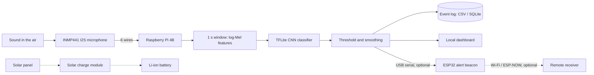

# Silent Guardian

**Raspberry Pi acoustic classifier for forest-sound demonstration: bird, chainsaw, gunshot-like sound and background.**

Status: planning and build documentation, v0.1, 28 November 2026.
Audience: ECE undergraduate team building an academic minor project.

> This is a student prototype. It is not a certified security, anti-poaching, wildlife-enforcement or life-safety system. All performance numbers in these documents are **targets or blanks to fill in after testing**. None have been measured yet.

---

## 1. What the project does

A small microphone listens to its surroundings. A Raspberry Pi 4B turns each 1-second slice of sound into a picture of its frequencies (a log-Mel spectrogram), and a small neural network decides what the sound most likely is:

| Class | Meaning |
|---|---|
| `bird` | A bird-like vocalisation. It does **not** name the species. |
| `chainsaw` | A chainsaw-like machine sound. It does not prove illegal logging. |
| `gunshot` | A gunshot-like sudden loud sound. It does not prove a real firearm. |
| `background` | Everything else: wind, rain, speech, fans, silence. |

The `background` class is deliberately added. Without it, every unknown sound would be forced into one of the other three.

## 2. System at a glance



Dotted lines are optional. The core project is: microphone → Pi → classifier → log and dashboard.

## 3. Which part does what

| Hardware you own | Job in this project |
|---|---|
| Raspberry Pi 4B (4 GB, 32 GB SD) | Runs the classifier, the dashboard and the event log. |
| INMP441 I2S microphone | Turns sound into digital audio. |
| ESP32 | Optional alert beacon (blinks an LED, sends a Wi-Fi message). It does **not** run the classifier in this design. |
| Solar panel DS-A-1.3 (1.3 W, 7.5 V at Pmax) | Optional charging experiment. See the power warning below. |
| Solar charging module | Charges the Li-ion battery from the panel. Model must be confirmed. |
| Li-ion battery 2500 mAh + holder | Stores energy for the ESP32 or small loads. |
| Breadboard and jumper wires | Temporary wiring. |

## 4. Important honest warnings

1. **The Pi 4B cannot run on your solar panel.**
   - A Pi 4B idles around 3 W (about 600 mA at 5 V) and officially needs a 5.1 V, 3 A supply. [Raspberry Pi power notes](https://forums.raspberrypi.com/viewtopic.php?t=351068)
   - Your panel gives at most 1.3 W in perfect sun.
   - Rough numbers: the Pi needs about 72 Wh a day; the panel might give about 3 Wh a day. That is roughly 4%. Your 2500 mAh battery holds about 9.25 Wh, which is a few hours of Pi.
   - Power the Pi from a proper 5 V / 3 A USB-C adapter or power bank. Use the solar parts for the ESP32 or as a charging demo.
2. **Your solar module may not accept your panel.** Some modules accept only about 4.4–6 V; your panel's best-power voltage is 7.5 V and its open-circuit voltage will be higher. Read `06_MISSING_COMPONENTS.md` and check the module name before connecting anything.
3. **The dataset sources differ a lot** (Xeno-canto birds, Rainforest Connection chainsaw clips, synthetic and Kaggle gunshots). A model can learn the recording style instead of the sound. You must test on recordings from your own microphone.
4. **Gunshot detection is experimental.** Only about 88 unique synthetic gunshot clips plus 851 Kaggle clips are in the CSV. Test with recorded playback only. Never use real firearms, blank guns or fireworks.

## 5. Documentation map

| File | Read it when |
|---|---|
| [`01_PRODUCT_REQUIREMENTS.md`](01_PRODUCT_REQUIREMENTS.md) | You need scope, requirements and acceptance tests. |
| [`02_AIML_WORKFLOW.md`](02_AIML_WORKFLOW.md) | You want to understand data → model → deployment. |
| [`03_ROADMAP_SOFTWARE_AIML.md`](03_ROADMAP_SOFTWARE_AIML.md) | You are ready to code, step by step. |
| [`04_ROADMAP_HARDWARE_ELI5.md`](04_ROADMAP_HARDWARE_ELI5.md) | You are about to touch wires. Written for a complete beginner. |
| [`05_ESP32_AND_ALERTS.md`](05_ESP32_AND_ALERTS.md) | You want the ESP32 alert beacon. |
| [`06_MISSING_COMPONENTS.md`](06_MISSING_COMPONENTS.md) | You are deciding what to buy or borrow. |

## 6. Suggested repository layout

```text
silent-guardian/
├── README.md
├── docs/                      # these files
├── data/
│   ├── raw/{bird,chainsaw,gunshot,background}/
│   ├── combined_shuffled-1.csv
│   ├── manifest_raw.csv
│   ├── manifest_clean.csv     # has: path,label4,group,split,license,source
│   └── features.npz
├── ml/
│   ├── build_manifest.py
│   ├── clean_audio.py
│   ├── sg_features.py         # SHARED with the Pi. Never edit only one copy.
│   ├── preprocess.py
│   ├── train.py
│   └── evaluate.py
├── artifacts/
│   ├── sg.tflite
│   └── norm.npy
├── pi/
│   ├── run_sg.py
│   ├── sg_features.py         # identical copy
│   └── send_alert.py
├── esp32/
│   └── alert_beacon/alert_beacon.ino
└── results/                   # confusion matrices, logs, power readings
```

## 7. Quick start (shortest path to a working demo)

1. Read `04_ROADMAP_HARDWARE_ELI5.md` and wire the microphone to the Pi (6 wires).
2. Confirm the Pi hears you: `arecord` test (hardware roadmap, Phase 3).
3. On the laptop: build the manifest, clean audio, extract features, train (software roadmap, Phases 1–6).
4. Copy `sg.tflite`, `norm.npy`, `sg_features.py` to the Pi.
5. Run `python run_sg.py` and play test sounds from a phone.
6. Record the results in `results/` and fill in the tables in the PRD.

## 8. Licences and data

- Birds come from Xeno-canto under mostly CC BY-NC-SA and CC BY-SA licences.
- Chainsaw clips are labelled CC BY-NC 4.0 in your CSV.
- Gunshot rows have a blank licence (synthetic set) or "Unknown" (Kaggle set). Check each source page before publishing anything.
- For an academic project this is workable. Keep an attribution file and do not use the data commercially.

## 9. Credits and references

- Adafruit: [I2S MEMS microphone on Raspberry Pi](https://learn.adafruit.com/adafruit-i2s-mems-microphone-breakout/raspberry-pi-wiring-test)
- DFRobot: [Solar Power Manager for 9V/12V/18V panels](https://www.dfrobot.com/product-1714.html)
- Google: [LiteRT / TensorFlow Lite](https://github.com/google-ai-edge/litert)
- Datasets: Xeno-canto, `rfcx/frugalai` (Hugging Face), Codec-SUPERB gunshot synthetic set, Kaggle gunshot audio dataset.
