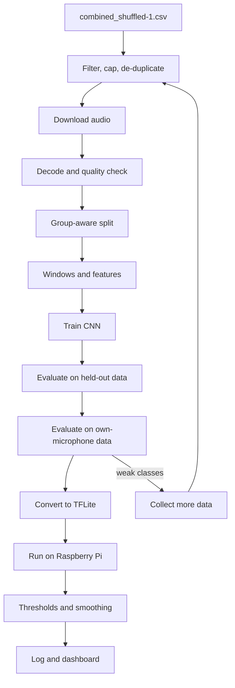

# AI/ML Workflow

How raw audio files become a classifier running live on the Raspberry Pi.

---

## 1. Overview



## 2. Classes

| Label | Source |
|---|---|
| `bird` | Xeno-canto clips from the CSV, capped per species |
| `chainsaw` | `rfcx/frugalai` clips listed in the CSV |
| `gunshot` | Synthetic originals (Codec-SUPERB set) plus Kaggle weapon clips |
| `background` | ESC-50 non-target sounds plus own recordings |

## 3. What we learned from the CSV

| Check | Finding |
|---|---|
| Rows | 30,570 |
| Labels | 193 = 182 bird species + `chainsaw` + `gunshot` + 9 weapon-labelled gunshot groups |
| Birds | 24,459 clips; 22 species at exactly 500, 12 species under 10 |
| Chainsaw | 3,500 clips from about 3,333 source recordings (3-second segments) |
| Synthetic gunshots | 1,760 files = 88 original clips × 20 versions (original plus 19 codec re-encodings) |
| Kaggle gunshots | 851 files |
| Exact duplicate rows or filenames | None |
| Conflicting labels | 19 Xeno-canto IDs appear under two different species (38 rows) |
| Missing licence | 1,760 synthetic gunshot rows; 851 Kaggle rows are "Unknown" |
| Missing class | No background or ambient sound |

Audio-level checks (duration, sample rate, silence, clipping, byte-identical files) have **not** been done yet. They need the downloaded files.

## 4. Cleaning rules

1. Drop the 38 conflicting bird rows.
2. Keep only `original_*` synthetic gunshot files. If you keep the codec versions, keep all 20 in the same split.
3. Cap each bird species (start at 60 clips). This gives 8,049 clips.
4. Hash every audio file. Delete byte-identical copies.
5. Delete files that fail to decode, are empty, or are near-silent.
6. Flag clipped files (many samples at ±full scale). Review a few by ear.
7. Convert every file to mono, 16 kHz, 32-bit float.
8. Normalise loudness with the same function used on the Pi.

## 5. Splitting without leakage

Assign groups first, split groups second, cut windows third.

| Class | Group key |
|---|---|
| Bird | Xeno-canto recording ID |
| Chainsaw | Filename without the `_start-end.wav` ending |
| Synthetic gunshot | The base clip number (all 20 versions together) |
| Kaggle gunshot | Filename, until you prove independence by audio checks |
| Background | Recording or session |

Split: 70% train, 15% validation, 15% test, fixed random seed.

Never touch the test set when choosing thresholds, augmentation or model size. Keep a **separate own-microphone test set** that is never used for training.

## 6. Windows and balance

| Class | Window rule |
|---|---|
| Bird | 1 s windows, hop 0.5 s; keep the 6 loudest per recording to avoid silent windows |
| Chainsaw | 1 s windows from each 3 s clip |
| Gunshot | One 1 s window centred around the loudest peak (peak about 0.25 s in) |
| Background | 1 s windows, random positions |

Aim for roughly equal windows per class in training. If one class is smaller, use weighted loss and gentle augmentation (not copy-paste).

## 7. Features

Shared function in `sg_features.py`, used by training and the Pi:

| Step | Setting |
|---|---|
| Sample rate | 16,000 Hz |
| Window length | 1.0 s (16,000 samples) |
| Remove DC | Subtract the mean |
| Loudness | RMS normalise to 0.1, gain capped at 10, clip to [-1, 1] |
| FFT size | 1024 |
| Hop | 256 samples |
| Mel bands | 64, 50–8000 Hz |
| Power to dB | `power_to_db`, 80 dB range |
| Feature shape | 64 × 63 |
| Standardisation | Training-set mean and standard deviation, saved in `norm.npy` |

If you change any setting, retrain and update the Pi copy at the same time.

## 8. Model

| Layer | Output |
|---|---|
| Input | 64 × 63 × 1 |
| Conv 16 + BN + ReLU + pool | 32 × 31 × 16 |
| Conv 32 + BN + ReLU + pool | 16 × 15 × 32 |
| Conv 64 + BN + ReLU + pool | 8 × 7 × 64 |
| Global average pool | 64 |
| Dropout 0.3 + Dense 4 | 4 scores |

Training choices: Adam, batch size 64, class-weighted loss, early stopping on validation macro-F1, fixed seed. Compare against a simple baseline (13 MFCC mean and standard deviation + logistic regression) so you can show whether the CNN truly helps.

## 9. Evaluation

Report all of these, for dataset-test and own-microphone sets **separately**:

- Accuracy, per-class precision, recall and F1, macro-F1.
- Confusion matrix.
- False alerts per hour on background-only recordings.
- A few spectrogram examples of wrong predictions, with your explanation.

Do not report one single accuracy that mixes the two test sets.

## 10. Conversion and deployment

```text
Keras model -> TFLite file (float, optionally dynamic-range quantised)
            -> copy sg.tflite + norm.npy + sg_features.py to the Pi
            -> run_sg.py: microphone -> features -> interpreter -> decision -> log
```

The Pi is a full Linux computer, so float TFLite is usually fine. Try quantisation only if timing needs it, and re-measure accuracy afterwards.

## 11. Decision logic on the Pi

| Rule | Why |
|---|---|
| Per-class thresholds (start: bird 0.75, chainsaw 0.85, gunshot 0.90) | Fewer false alarms for serious classes. Tune on validation data only. |
| Bird and chainsaw: need two matching windows in a row | These sounds usually last longer than a second. |
| Gunshot: test a single-window rule | A shot is brief and may appear in only one window. Measure false alarms with claps and door slams. |
| Cooldown (e.g. 5 s) | Avoid repeating the same event. |
| Heartbeat line in the log | Shows the system is alive, even when silent. |

A softmax score is the model's relative preference, not a guaranteed probability.

## 12. Retraining loop

1. Run live tests and save short clips of every mistake (with consent where voices are possible).
2. Add them to the training set, grouped by session.
3. Retrain.
4. Re-evaluate on the **untouched** own-microphone test set.

## 13. Reproducibility

- Save `manifest_clean.csv`, split files, random seed, package versions (`pip freeze`), and trained files with dates.
- Never train on a file listed in the test set.
- Record which dataset versions and download dates you used.

## 14. Known limitations to state in the report

- Birds are one class; species are not identified.
- Chainsaw sound is not proof of illegal activity.
- Gunshot data is mostly synthetic or of uncertain independence; real-forest performance is unknown.
- A silent person or a quiet machine may not be detected.
- Playback through a phone speaker differs from the real sound.
- Datasets are non-commercial and come from different recording conditions.
